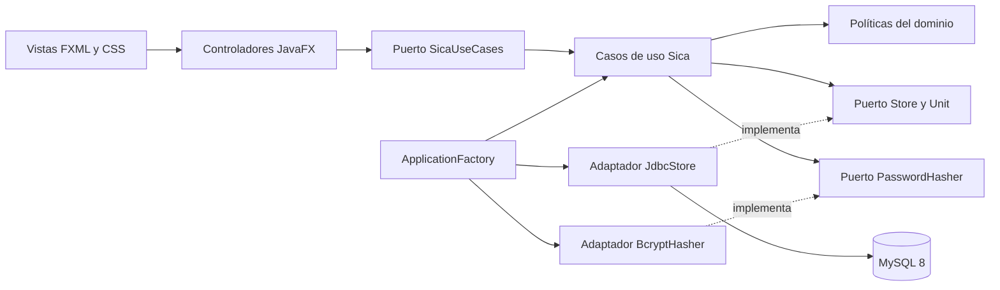
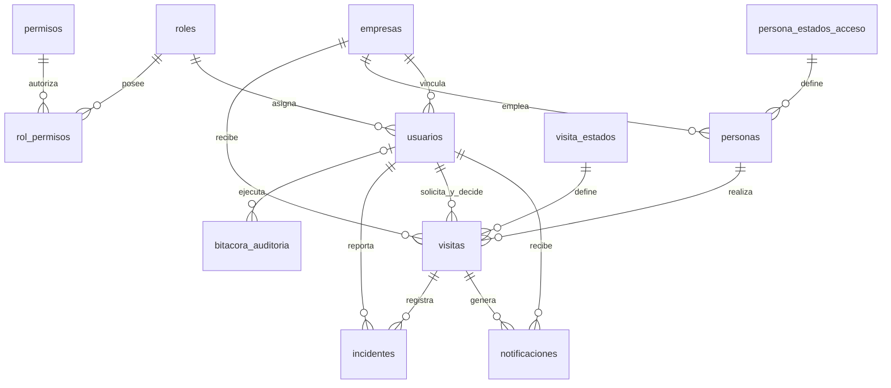

# SICA · Sistema Integrado de Control de Acceso

Aplicación de escritorio para Zona Acme. Gestiona usuarios, empresas, trabajadores, invitados, autorizaciones, entradas, salidas, incidentes y auditoría mediante datos persistidos en MySQL.

El proyecto se creó desde cero a partir de la especificación textual suministrada. El esquema SQL concreta las tablas y relaciones de esa especificación. Las bajas de usuarios, empresas y personas son lógicas para conservar los registros históricos.

## Tecnologías

Java 21, JavaFX 21 con FXML y CSS, Maven Wrapper 3.9.9, MySQL 8.4, JDBC con Connector/J, BCrypt con coste 12, ZXing para códigos QR, SLF4J, Logback y JUnit 5. La ejecución de pruebas de integración utiliza MySQL real.

## Puesta en marcha

Se necesitan JDK 21 y Docker Desktop activo para la instalación incluida. Maven Wrapper descarga Maven y las dependencias en su primera ejecución.

1. Copiar la configuración de ejemplo y asignar dos contraseñas diferentes.

   ```sh
   cp .env.example .env
   ```

2. Editar los valores de `SICA_DB_PASSWORD` y `MYSQL_ROOT_PASSWORD` de `.env`. Las líneas usan el formato literal `CLAVE=valor`, sin comillas. El archivo está excluido de Git.

3. Iniciar MySQL e instalar el esquema y los catálogos.

   ```sh
   docker compose up -d --wait
   ```

4. Añadir a `.env` las credenciales del superusuario que se desea crear.

   ```dotenv
   SICA_ADMIN_EMAIL=admin@acme.local
   SICA_ADMIN_PASSWORD=asigna-una-contraseña-propia
   ```

5. Crear el superusuario y abrir la aplicación.

   ```sh
   ./scripts/sica --create-admin
   ./scripts/sica
   ```

El alta inicial queda auditada. Las contraseñas de usuarios se guardan como hashes BCrypt. Las variables de entorno tienen prioridad sobre el archivo local. Se puede indicar otro archivo con la propiedad Java `-Dsica.env.file=/ruta/config.env`.

En este espacio de trabajo ya se generó `.env`, se inició MySQL y se creó el administrador `admin@sica.local`. Su contraseña está en `SICA_ADMIN_PASSWORD` dentro de ese archivo local.

### Instalación en MySQL existente

Ejecutar `src/main/resources/db/schema.sql` y después `data.sql` en una base vacía con una cuenta administradora. Ambos archivos usan la base `sica`. El instalador de consola también permite crearla.

```sh
SICA_DB_USER=root SICA_DB_PASSWORD='clave-administrativa' ./mvnw javafx:run -Djavafx.args=--init-db
```

`SICA_DB_ADMIN_URL` permite cambiar la conexión del instalador. El script DDL es de instalación inicial. MySQL confirma DDL de forma implícita, por lo que una instalación interrumpida requiere revisar los objetos creados antes de volver a ejecutarla.

Crear una cuenta de aplicación y asignarle los permisos equivalentes a `db/privileges.sql`. El Compose incluido crea la cuenta `sica` y aplica estos privilegios automáticamente. Usar esa cuenta para el cliente de escritorio.

| Variable | Uso |
| --- | --- |
| `SICA_DB_USER` | Cuenta JDBC, por defecto `sica` |
| `SICA_DB_PASSWORD` | Contraseña JDBC obligatoria |
| `SICA_DB_PORT` | Puerto local, por defecto `3306` |
| `SICA_DB_URL` | URL JDBC completa opcional |
| `SICA_ZONE` | Zona del reloj de negocio, por defecto `America/Bogota` |
| `SICA_ADMIN_EMAIL` | Correo del alta inicial por consola |
| `SICA_ADMIN_PASSWORD` | Contraseña del alta inicial por consola |

La instalación incluida configura MySQL en UTC−05 y el cliente en `America/Bogota`. Todas las instancias deben compartir la misma zona de negocio. Para una conexión remota, configurar la URL JDBC y la configuración TLS de Connector/J de acuerdo con el servidor utilizado.

El volumen `sica-data` conserva la información. `docker compose stop` detiene MySQL y `docker compose start` lo vuelve a iniciar.

## Comandos de desarrollo

```sh
./mvnw clean verify
./mvnw javafx:run
./scripts/test-mysql -B -ntp
./scripts/package-desktop
```

`./mvnw javafx:run` lee `.env` desde el directorio de ejecución. Los scripts sitúan el proceso en la raíz del proyecto.

`package-desktop` genera una imagen nativa con JDK y dependencias en un directorio fechado bajo `target/desktop-…`. En macOS produce `SICA.app`. Se construye para el sistema operativo y la arquitectura del equipo que ejecuta `jpackage`. El paquete apunta al archivo `.env` del proyecto donde se generó. Al trasladarlo, ajustar `sica.env.file` en la configuración del lanzador o utilizar variables de entorno. El paquete local tiene firma ad hoc de desarrollo.

## Guía de uso

### Administración y catálogos

El superusuario inicia sesión, crea empresas activas y registra usuarios con su rol. Cada funcionario debe tener una empresa asignada. En Personas se registran trabajadores e invitados con documento único, nombre, empresa, estado de acceso y foto HTTPS opcional.

Las tablas permiten buscar por documento, nombre, empresa y otros campos visibles. Las fechas Desde y Hasta incluyen ambos días. Los formularios mantienen los datos cuando falla una validación y muestran el error junto a los campos.

Los botones Editar y Dar de baja operan sobre la fila seleccionada. La baja conserva las visitas, incidentes y auditorías asociadas. Una persona restringida o de baja tiene bloqueado el ingreso. La inactividad de su empresa o de la anfitriona también impide entrar.

### Roles iniciales

| Rol | Operaciones iniciales |
| --- | --- |
| Superusuario · `SUPER` | Administración completa, aprobaciones, acceso, incidentes, reportes y auditoría |
| Supervisor de Seguridad · `SUPERVISOR` | Personas, solicitudes de ingreso, entradas y salidas, incidentes, reportes y auditoría |
| Guarda de Seguridad · `GUARDA` | Consulta de personas y visitas, registro de invitados, solicitudes, acceso e incidentes |
| Funcionario de Empresa · `FUNCIONARIO` | Invitados, prerregistro, decisiones y reportes de su propia empresa |

`data.sql` instala roles, permisos y estados. El superusuario inicial se crea con las credenciales locales elegidas. Se pueden crear cuentas como `supervisor@acme.local`, `guarda@acme.local` y `funcionario@empresa.local` desde Usuarios y asignar contraseñas individuales de al menos 12 caracteres.

Los permisos se consultan desde `usuarios → roles → rol_permisos → permisos` en cada operación protegida. Los cambios realizados en MySQL se aplican a las sesiones existentes. La sesión se invalida al cerrarla y los usuarios inactivos pierden acceso inmediatamente a las operaciones de aplicación.

### Invitado prerregistrado

1. Registrar al invitado en Personas.
2. En Registro de visitas elegir Registrar visita y seleccionar `PREVIA`.
3. Seleccionar la empresa anfitriona y el intervalo autorizado. La visita se crea aprobada y auditada.
4. El guarda busca el documento en Entradas y salidas, consulta la fotografía y registra la entrada.
5. Al salir, selecciona la visita y registra la salida.

### Invitado no anunciado

1. El guarda registra al invitado y crea una visita `NO_ANUNCIADA`.
2. La solicitud queda pendiente. El intento de entrada se rechaza hasta que exista aprobación vigente.
3. El funcionario ve el contador de pendientes y su lista actualizada, selecciona la fila y aprueba o rechaza.
4. La pantalla del guarda obtiene el cambio en la siguiente consulta periódica, dentro de unos cinco segundos más el tiempo de consulta.
5. El guarda registra la entrada dentro del horario aprobado.

### Trabajador sin carnet

Buscar al trabajador y crear una solicitud `SIN_CARNET` para su empresa. El inicio debe pertenecer al día actual y el fin puede llegar hasta la medianoche siguiente. Tras la aprobación del funcionario, se registra el ingreso durante ese intervalo. Una solicitud expirada requiere una nueva autorización.

### Salida olvidada

Al registrar una nueva entrada aprobada para una persona con una visita abierta, el sistema cierra la anterior con estado `SALIDA_OLVIDADA`, registra su salida, audita la regularización y abre la nueva entrada en la misma transacción. Se aplica también a visitas del mismo día, conforme a la especificación textual.

La visita anterior se conserva con el nombre de estado “Cerrada por Sistema (Salida Olvidada)”. La nueva visita debe contar con su propia autorización vigente.

### Incidentes, auditoría e informes

Incidentes permite reportar una descripción asociada a un ID de visita. Desde Entradas y salidas se puede iniciar el reporte usando la visita seleccionada. Se guardan el usuario responsable y la hora.

Auditoría permite consultar acciones, usuario, tabla, identificador y detalles. Los permisos SQL y los triggers impiden modificar o eliminar su contenido mediante la cuenta de aplicación.

Reportes incluye personas dentro, historial de entradas y salidas, visitas por fecha, decisiones, incidentes y auditoría de acuerdo con los permisos. Se filtra por búsqueda, fechas y estado. Exportar CSV vuelve a consultar los datos con autorización vigente y escribe UTF-8 con protección frente a fórmulas de hoja de cálculo.


## Notificaciones, motivos de decisión y QR

### Bandeja persistente

Cada usuario dispone de una pantalla Notificaciones con fecha, visita, evento, mensaje y estado leído o sin leer. El encabezado muestra el contador de avisos sin leer y la pantalla se actualiza mediante el sondeo existente.

Las solicitudes pendientes notifican a los usuarios activos con permiso DECIDIR. Los funcionarios reciben las solicitudes de su empresa. Una aprobación o rechazo avisa al solicitante y a los guardas autorizados para operar el acceso. La creación de la visita o su decisión, las notificaciones y la auditoría comparten transacción.

Marcar como leída guarda la fecha de lectura y registra la acción una sola vez, incluso con lecturas simultáneas. Cada usuario accede a su propia bandeja. Consultar visita vuelve a validar los permisos y el alcance de empresa antes de mostrar los detalles.

### Motivos de aprobación y rechazo

Los botones Aprobar y Rechazar abren un formulario con motivo obligatorio, hasta 1000 caracteres. El texto se conserva junto al usuario y fecha de decisión, aparece en las columnas DecididoPor y Motivo de visitas e informes, y queda registrado en auditoría.

El prerregistro guarda el motivo automático “Registro anticipado autorizado”. Las decisiones antiguas migradas se identifican como “Decisión anterior a la incorporación de motivos”.

### Credenciales QR temporales

El permiso granular QR_EMITIR se asigna inicialmente a Superusuario, Supervisor y Funcionario. El funcionario emite credenciales para visitas de su propia empresa. Las visitas deben estar aprobadas y conservar una fecha de vencimiento futura.

1. Seleccionar la visita en Registro de visitas o Solicitudes.
2. Elegir Emitir o renovar QR y confirmar. Una reemisión invalida el código anterior.
3. Guardar la imagen PNG para entregar la credencial al visitante.
4. En Entradas y salidas, el guarda utiliza Ingresar con QR para recibir el texto de un lector USB o pegarlo. También puede usar Ingresar con imagen QR para leer una imagen PNG o JPEG.
5. La aplicación comprueba el permiso ACCESO, el horario, la aprobación, las restricciones de la persona y las empresas antes de registrar la entrada.

El código contiene una credencial aleatoria de 256 bits. MySQL conserva su digest SHA-256 y el vencimiento de la visita. El texto del código queda fuera de informes y auditoría. Un ingreso correcto consume el código, incluyendo los ingresos registrados manualmente. Una imagen QR puede leerse en otro equipo conectado a la misma base. La hora de inicio también se comprueba al escanear un código emitido anticipadamente.

El lector de imágenes admite archivos de hasta 10 MB y 16 millones de píxeles. El flujo admite lectores que escriben como teclado y archivos de imagen.

### Actualizar una instalación existente

Las instalaciones nuevas reciben los campos y la tabla adicionales desde schema.sql. Una instalación existente se actualiza con una cuenta administrativa mediante este comando.

```sh
SICA_DB_USER=root SICA_DB_PASSWORD='clave-administrativa' ./scripts/sica --migrate-db
```

Después, aplicar src/main/resources/db/privileges.sql para conceder acceso a la tabla de notificaciones. En el Compose incluido se puede ejecutar desde la raíz del proyecto.

```sh
docker compose exec -T mysql sh -c 'MYSQL_PWD="$MYSQL_ROOT_PASSWORD" exec mysql -uroot' < src/main/resources/db/privileges.sql
```

El migrador conserva las visitas y decisiones existentes, identifica los motivos históricos ausentes y crea avisos para las solicitudes pendientes vigentes. Un bloqueo de MySQL serializa las migraciones concurrentes y las comprobaciones de metadatos permiten repetir una actualización interrumpida. Las asignaciones de permiso personalizadas se conservan al repetir el comando. La creación de objetos usa DDL de MySQL, con confirmación implícita. Las actualizaciones de datos y sus registros de auditoría comparten transacción.

La base local de este espacio de trabajo ya fue migrada y tiene los privilegios actualizados.

## Arquitectura hexagonal y MVC

El dominio contiene las políticas de acceso, los contratos de entrada y salida y los registros de datos. Los contratos carecen de dependencias de JavaFX, JDBC y MySQL.

`Sica` implementa el puerto de entrada `SicaUseCases`. Sus casos de uso dependen de los puertos `Store` y `PasswordHasher`, recibidos por constructor. `Store.Unit` delimita un repositorio transaccional compartido por una operación y su auditoría. `JdbcStore` lo adapta a JDBC.

`ApplicationFactory` compone JDBC, BCrypt y el reloj. `DesktopApplication` compone los controladores y el ejecutor de trabajo.



MVC organiza la presentación. FXML y CSS definen las vistas, los controladores gestionan la navegación y traducen acciones a casos de uso, y `DashboardViewModel` con `TablePresenter` representa el estado que se muestra. La validación de autorizaciones, estados y transacciones permanece en los casos de uso.

```text
src/main/java/com/sica/
  domain/
    AccessPolicy, CredentialCodes, Session, SicaException
    port/in/SicaUseCases
    port/out/Store, PasswordHasher
  application/
    Sica, VisitCommand
  infrastructure/
    JdbcStore, ReportQuery, BcryptHasher, Configuration,
    ApplicationFactory, DatabaseInstaller, DatabaseMigrator, QrCodec, CsvExporter, LocalEnvironment
  presentation/
    DesktopApplication, LoginController, ShellController,
    EntityEditor, VisitEditor, CredentialDialog, FormDialog, TablePresenter,
    DashboardViewModel, BackgroundTasks
  Main
src/main/resources/
  fxml/       login.fxml, shell.fxml, credential.fxml
  css/        sica.css
  db/         schema.sql, data.sql, privileges.sql
  logback.xml
src/test/java/com/sica/
```

Las pantallas de gestión usan una vista de tabla compartida con columnas y acciones configuradas por módulo. Los formularios se construyen mediante `FormDialog`. El flujo cubre login, panel principal, usuarios, empresas, personas, visitas, acceso, pendientes, aprobación, incidentes, auditoría y reportes.

### Principios SOLID

| Principio | Aplicación |
| --- | --- |
| Responsabilidad única | Las políticas, SQL, hash, CSV, formularios y navegación tienen clases propias |
| Abierto/cerrado | Se pueden añadir adaptadores implementando los puertos de persistencia y hash |
| Sustitución de Liskov | El servicio usa los contratos de los puertos y las pruebas sustituyen el almacenamiento |
| Segregación de interfaces | El cifrado de contraseñas se limita a `PasswordHasher`; `Store.Unit` expone las operaciones que comparten transacción |
| Inversión de dependencias | Los casos de uso reciben interfaces y el reloj mediante constructor |

### Patrones implementados

| Patrón | Clases | Problema resuelto |
| --- | --- | --- |
| Repository y Unit of Work | `Store`, `Store.Unit`, `JdbcStore` | Acceso persistente y transacciones que incluyen auditoría |
| Adapter | `JdbcStore`, `BcryptHasher`, controladores | Integración de JDBC, BCrypt y JavaFX con los contratos del sistema |
| Strategy | `AccessPolicy`, `PasswordHasher` | Políticas diferenciadas de ingreso y algoritmo de hash intercambiable |
| Observer | `DashboardViewModel`, bindings y listeners en `ShellController` | Actualización de indicadores y avisos al cambiar los pendientes |
| Command | `VisitCommand.CheckIn`, `CheckOut`, `Decide` | Acciones de acceso representadas por objetos y despachadas con confirmación |
| Factory | `ApplicationFactory` | Construcción centralizada de las dependencias de producción |

## Base de datos y consistencia



El esquema incorpora los campos mínimos para materializar los flujos descritos.

- `usuarios.empresa` limita el alcance del funcionario.
- `personas.tipo`, `foto` y `estado` distinguen invitados, trabajadores y restricciones.
- `visitas.tipo`, `inicio`, `vence` y los campos de decisión mantienen la autorización temporal y su responsable.
- `visitas.persona_dentro` es una columna generada con índice único. Garantiza una sola visita abierta por persona.
- Las claves foráneas conservan la integridad entre personas, empresas, usuarios, visitas y catálogos.
- Los estados de salida normal y salida olvidada conservan el historial.
- Los triggers de auditoría rechazan UPDATE y DELETE.

Cada operación crítica usa una conexión JDBC con `autoCommit=false`, aislamiento READ COMMITTED y rollback ante fallos. El ingreso bloquea la persona con `SELECT … FOR UPDATE` antes de comprobar y modificar sus visitas. Las decisiones y salidas bloquean la visita. El índice único refuerza la exclusión entre clientes concurrentes.

Las sentencias reciben valores por `PreparedStatement`. Los nombres de tablas y las plantillas de informes se seleccionan mediante enumeraciones internas. Las contraseñas y hashes quedan fuera de las tablas de consulta y de los mensajes de auditoría.

## Concurrencia y errores

`BackgroundTasks` ejecuta JDBC, autenticación, exportación y formularios fuera del JavaFX Application Thread. Un ejecutor planificado realiza consultas cada cinco segundos cuando la pantalla está disponible. `Platform.runLater` entrega resultados al hilo gráfico. La pantalla evita consultas periódicas superpuestas y conserva la fila seleccionada cuando refresca.

Las fotografías se cargan en segundo plano desde la URL HTTPS y muestran un error si la descarga falla. Al cerrar la aplicación se cancela el sondeo y se finaliza el ejecutor. Los tiempos de conexión y lectura JDBC limitan las esperas de red.

`SicaException` lleva mensajes comprensibles. La adaptación JDBC traduce duplicados, fallos de conexión y conflictos de bloqueo. Los detalles técnicos se registran con SLF4J/Logback. Si la inserción de auditoría falla, se cancela la operación de datos completa. El cierre de sesión revoca primero el token local y registra un aviso técnico si MySQL impide auditar LOGOUT, para permitir salir incluso durante una caída de la base.

## Pruebas

`./mvnw test` ejecuta las pruebas independientes de MySQL. Las pruebas de integración se habilitan cuando existe `SICA_TEST_DB_PASSWORD`.

`./scripts/test-mysql -B -ntp` inicia el MySQL del proyecto, toma la contraseña administrativa local y ejecuta también las pruebas de integración. Cada ejecución crea una base temporal con nombre aleatorio y la elimina al finalizar. La cuenta usada para esta suite necesita permisos para crear y eliminar esa base de pruebas.

La prueba gráfica se habilita mediante `SICA_UI_TEST=true` y crea una base temporal propia con las credenciales administrativas de pruebas. Carga FXML, valida el login, comprueba los menús de los cuatro roles y ejecuta un flujo completo desde dos interfaces independientes. Las pruebas generan imágenes bajo `target/ui` y eliminan sus bases temporales al finalizar.

```sh
SICA_UI_TEST=true ./scripts/test-mysql -B -ntp
```

Para otro servidor se pueden definir `SICA_TEST_DB_URL`, `SICA_TEST_DB_USER` y `SICA_TEST_DB_PASSWORD` y ejecutar Maven directamente. La URL de pruebas debe apuntar al servidor sin seleccionar una base.

La suite comprueba también la reinstalación de privilegios y el flujo completo con una cuenta JDBC restringida, equivalente a la de la aplicación desplegada. Las interfaces de prueba también operan con estos permisos restringidos.

La suite cubre notificaciones privadas y persistentes, motivos de decisión, migración desde datos antiguos, reemisión y consumo concurrente de QR, lectura de imágenes, autenticación, sesiones revocadas y falsificadas, usuarios inactivos, RBAC, límites horarios, los cuatro escenarios de acceso, decisiones, ámbito por empresa, duplicados, restricciones, incidentes, reportes, inyección SQL, BCrypt, CSV, concurrencia y rollback por fallos de auditoría. Los fallos SQL provocados por las pruebas de duplicados y auditoría producen entradas ERROR esperadas en el log.

## Desarrollo por fases y Git

El repositorio utiliza ramas `main` y `develop`, ramas de funcionalidad y Conventional Commits. Las entregas se integran mediante merge y las correcciones pueden usar ramas `hotfix/…`.

| Fase | Archivos principales y verificación |
| --- | --- |
| 1 · Configuración y arquitectura | `pom.xml`, Maven Wrapper y puertos. Compilación Java 21 |
| 2 · Persistencia | `schema.sql`, `data.sql`, `privileges.sql`, `JdbcStore`. Instalación en MySQL 8 |
| 3 · Seguridad | `Sica`, `BcryptHasher`, sesiones y auditoría. Pruebas de autenticación y RBAC |
| 4 · Entidades | Casos de uso CRUD y `EntityEditor`. Duplicados, bajas y restricciones |
| 5 · Acceso | `AccessPolicy`, `VisitCommand`, transacciones. Escenarios A, B, C y D |
| 6 · Concurrencia | `BackgroundTasks`, `DashboardViewModel`. Prueba de ingresos concurrentes y actualización periódica |
| 7 · Interfaz e informes | FXML, CSS, controladores y CSV. Compilación y ejecución del escritorio |
| 8 · Verificación | JUnit 5, integración MySQL y esta guía. Corrección de errores y empaquetado |

Para conectar el repositorio local a un repositorio de GitHub elegido por el propietario, configurar su URL como remoto `origin` y publicar las ramas de trabajo. La configuración local de credenciales queda excluida del historial.

### Resultado de verificación en este equipo

El 18 de noviembre de 2026 se ejecutó la suite completa con MySQL 8.4 y renderizado JavaFX. Pasaron 42 pruebas, con cero fallos, cero errores y cero omisiones. Las imágenes generadas se revisaron para comprobar el diseño del login, el panel, los reportes, la credencial QR y la entrada registrada.

La aplicación instalada se comprobó mediante inspección nativa. Se reprodujo y corrigió un permiso faltante sobre notificaciones causado por la interrupción del script al repetir la instalación de privilegios. El script ahora admite esa repetición y las consultas del panel y la bandeja quedaron verificadas con la cuenta real de aplicación. Los controles JavaFX de solicitud, lectura de avisos, aprobación con motivo, emisión de QR e ingreso se probaron de extremo a extremo. Los selectores nativos de archivos CSV y PNG quedan pendientes de comprobación manual.
